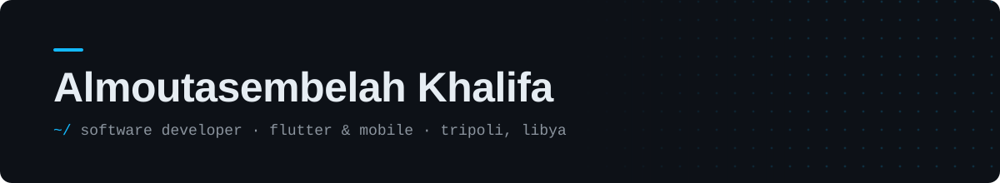
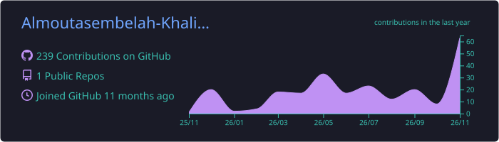

<!-- Header -->
<p align="center">
  
</p>

<p align="center">
  <a href="https://almoutasem.ly">
    
  </a>
</p>

<p align="center">
  <a href="https://almoutasem.ly"></a>
  <a href="https://linkedin.com/in/almoutasembelah-khalifa"></a>
  <a href="mailto:contact@almoutasem.ly"></a>
  
</p>

---

## 👋 About Me

```dart
class Almoutasem extends Developer {
  final String location   = "Tripoli, Libya 🇱🇾";
  final String role       = "Software Developer · Flutter & Mobile";
  final String status     = "Freelancing — open to new projects";
  final String education  = "B.Sc. Computer Science";
  final List<String> languages = ["Arabic (Native)", "English (C1 · IELTS)"];

  final List<String> superpowers = [
    "Android + iOS apps from one Flutter codebase",
    "Building screens straight from Figma files",
    "Designing PostgreSQL schemas & RPCs on Supabase",
    "Phone/OTP auth, wallet payments, realtime sync",
    "Arabic + English apps with proper RTL layouts",
  ];
}
```

---

## 🛠️ Tech Stack

### 📱 Mobile
<p>
  
  &nbsp;
  
  
  
  
</p>

### 🗄️ Backend & Databases
<p>
  
  &nbsp;
  
</p>

### 🌐 Web
<p>
  
</p>

### 💻 Languages
<p>
  
</p>

### 🧰 Tools
<p>
  
  &nbsp;
  
</p>

### 🧠 Concepts
`Clean Architecture` · `OOP` · `Algorithms & Data Structures` · `Mobile Security (OWASP MASVS)` · `Localization & RTL` · `Real-time Sync` · `State Management`

---

## 🚀 Featured Projects

<table>
  <tr>
    <td width="50%" valign="top">
      <h3>🏠 Property Rental Marketplace</h3>
      <p>Cross-platform rental marketplace powered end to end by Supabase.</p>
      <ul>
        <li>📲 Phone + OTP auth via Supabase Auth & a local SMS provider</li>
        <li>🔎 Filterable search built on PostgreSQL RPCs</li>
        <li>💳 Booking flow with wallet-escrow payments & host approval</li>
        <li>🌍 Full English / Arabic with RTL support</li>
      </ul>
      
      
      
    </td>
    <td width="50%" valign="top">
      <h3>🏜️ Hidden Libya</h3>
      <p>Mobile tour guide app for discovering Libya's hidden gems.</p>
      <ul>
        <li>⚡ Live data sync across devices with Supabase Realtime</li>
        <li>🗺️ Searchable database of 14+ attractions</li>
        <li>📸 User reviews & photo uploads via Supabase Storage</li>
        <li>🌐 Multilingual, localized interface</li>
      </ul>
      
      
      
    </td>
  </tr>
  <tr>
    <td colspan="2" valign="top">
      <h3>✨ Personal Portfolio — <a href="https://almoutasem.ly">almoutasem.ly</a></h3>
      <p>Responsive portfolio built with Next.js & TypeScript, styled with Tailwind, with full English and Arabic (RTL) versions.</p>
      
      
      
      
    </td>
  </tr>
</table>

---

## 🏆 Certifications & Achievements

<p>
  
  
  
  
</p>

---

## 📊 GitHub Stats

<!-- Cards generated by .github/workflows/profile-cards.yml -->
<p align="center">
  
</p>

<p align="center">
  
</p>

<!-- Contribution snake: generated by .github/workflows/snake.yml -->
<p align="center">
  <picture>
    <source media="(prefers-color-scheme: dark)" srcset="https://raw.githubusercontent.com/Almoutasembelah-Khalifa/Almoutasembelah-Khalifa/output/github-contribution-grid-snake-dark.svg" />
    
  </picture>
</p>

---

<p align="center">
  <i>💬 Have an app idea? Let's build it — <a href="mailto:contact@almoutasem.ly">contact@almoutasem.ly</a></i>
</p>


